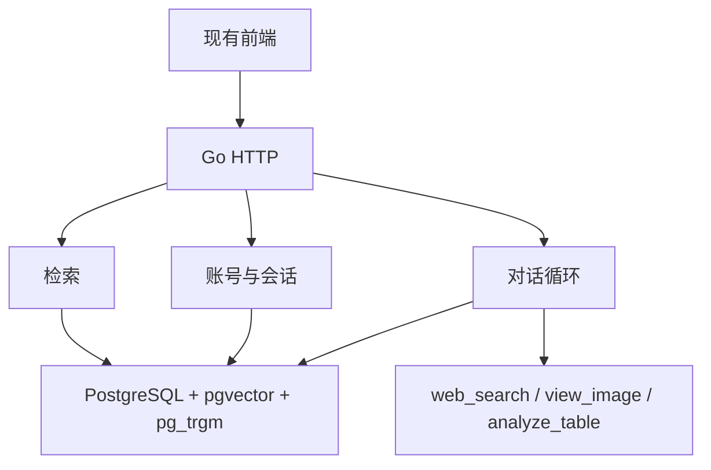

# chat-lite Go 后端

Go 后端在这个目录里。现有 Node 后端和 SQLite 数据仍然留在仓库原来的位置，这里不替换它们。

数据库只用 PostgreSQL + pgvector。关键词用 Postgres 的 `pg_trgm`。没有 Milvus，也没有 Elasticsearch。

## 当前能力

- 账号：注册、登录、退出、邮箱验证码、忘记密码、改密码、头像。
- 会话：列表、置顶、改名、删除，以及消息对的编辑和删除。
- 对话：`POST /api/chat` 用 SSE 输出。工具有 `web_search`、`view_image`、`analyze_table`。
- 检索：子块做向量和关键词，父块原文交给模型。向量距离大于 `0.4` 的候选在合并前丢掉。
- 图片生成页、上传、工作区文件、用量统计。
- 健康检查：`GET /api/health`。

## 架构概览



## 技术栈

- Go 1.26
- `net/http`
- PostgreSQL 16 + pgvector
- 源数据仍是 SQLite：`data/app.db` 和 `data/rag.db`

## 快速开始

### 1. 启动数据库

在 `go/` 目录：

```bash
docker compose up -d
```

Postgres 监听 `localhost:5432`，库名、用户名、密码都是 `chatlite`。

### 2. 改配置

配置文件是 `config/config.yaml`，对应 Spring 的 `application.yml`。启动时整份读进结构体。密钥写成 `${环境变量名}`，不要把真实密钥写进文件。

数据库地址在 `postgres.url`。留空时进程仍能启动，需要数据库的接口会返回 500。

### 3. 启动后端

在 `go/` 目录：

```bash
go run ./cmd/server
```

默认地址是 `http://localhost:3000`。

### 4. 迁移旧数据

先改 `cmd/migrate/main.go` 最上面的三个连接串，再选择 `migrateMode`。

- `one`：只迁最早的 1 个用户，以及该用户的 1 条会话、1 条消息和相关行。
- `all`：迁全部业务表和 RAG 文本。

```bash
go run ./cmd/migrate
```

SQLite 里的向量存在 sqlite-vec 虚表中。当前进程读不到这块扩展时，只迁 RAG 文本，不迁向量，并在日志里说明。向量维度不是 1536 的记录也不会写入 `embedding` 列。

迁移可以重复执行。已存在的主键会跳过。
